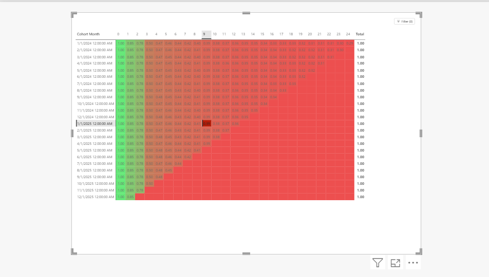
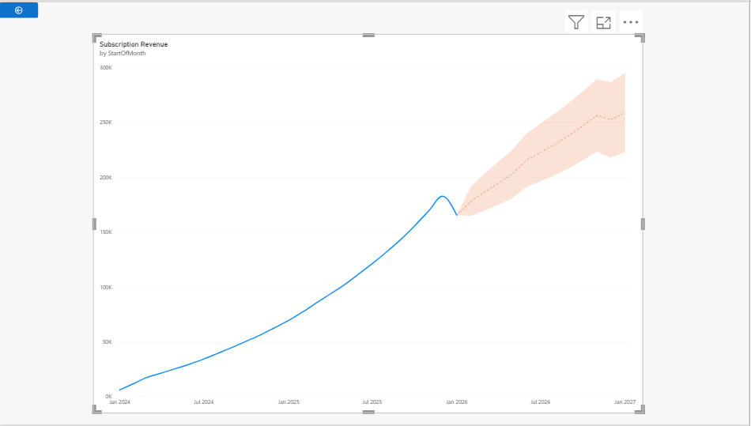
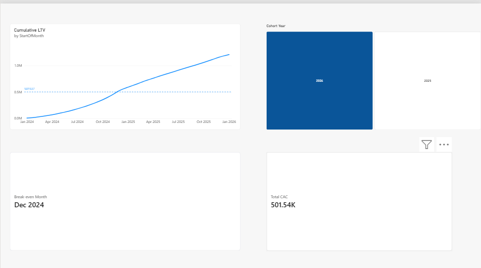
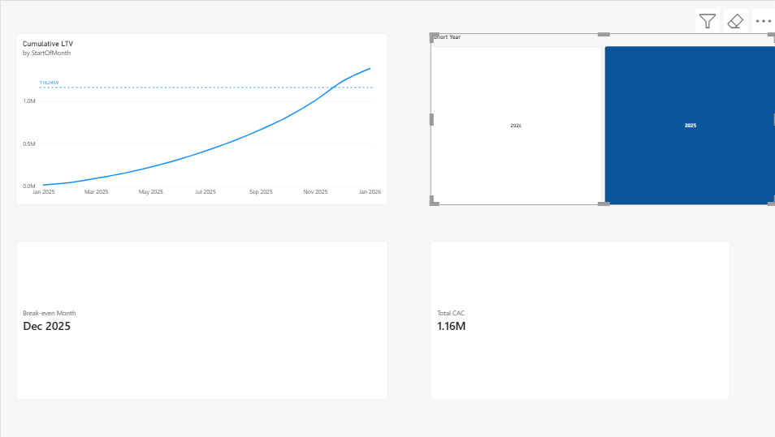

# FitnessHub Subscription Analytics

**Tool:** Power BI Desktop · **Data:** `data/Fitness_Subscriptions_Dataset.xlsx` (sheets `customers`, `transactions`)

FitnessHub is a subscription fitness platform that has grown quickly but loses many customers in their first few months. This report answers three questions for the executive team: when customers cancel, how much subscription revenue to expect over the next 12 months, and how long the 2024 and 2025 cohorts take to pay back their acquisition cost.

## Dataset

| Sheet | Rows | Notes |
|---|---|---|
| customers | 9,300 | One row per customer; CAC ranges from $21.00 to $352.46 (mean $178.92) |
| transactions | 64,979 | 1 Jan 2024 – 31 Jan 2026; `Transaction_Date` loaded as **Date** |

No missing values in either sheet. Transaction types: Subscription (51,982 rows, $2,006,148), Fitness Challenge ($178,700), Nutrition Plan ($152,061), Personal Training ($128,700), Annual Upgrade ($129,350). Total revenue: $2,594,959.

**Definitions used**
- **Cohort Month** = month of the customer's first transaction (the customers sheet has no signup date). Every customer's first transaction falls in the same month as their first subscription payment. Cohorts run from Jan 2024 (156 customers) to Dec 2025 (769 customers); there are no new customers in Jan 2026.
- **Active customer in month N** = customer with a `Subscription` transaction N months after their Cohort Month. Retention % = active customers in month N ÷ cohort size (month 0).
- **Subscription revenue** = revenue where `Transaction_Type = "Subscription"`.
- **LTV** = all revenue (subscriptions + add-ons) generated by a cohort's customers. **Total CAC** = sum of `CAC` for the same customers.

## Data model

`customers[Customer_ID]` 1 → * `transactions[Customer_ID]`, and `dim_date[Date]` 1 → * `transactions[Transaction_Date]`. `dim_date` is built with `ADDCOLUMNS(CALENDAR(...))` and includes a `StartOfMonth` column.


## 1. Customer Cohort: when do customers cancel?



| Months since cohort | 0 | 1 | 2 | **3** | 4 | 6 | 12 | 24 |
|---|---|---|---|---|---|---|---|---|
| Retention (all cohorts pooled) | 100% | 84.99% | 78.01% | **50.01%** | 47.47% | 43.56% | 35.73% | 29.49% |

- **Customers typically cancel after their third month.** Retention falls from 78.0% in month 2 to 50.0% in month 3, a drop of 28.0 percentage points, the largest in the lifecycle. This is the largest drop in all 22 cohorts that have reached month 3.
- A second, smaller drop happens right after the first month (100% → 85.0%, −15.0 pts).
- After month 3, churn slows to between about 0.4 and 2.5 points per month. The Jan 2024 cohort, the only cohort observed for 24 months, still retains 29.5% of its customers.
- Of the 5,025 customers who cancelled before January 2026, 2,188 (43.5%) cancelled after exactly 3 paid months and 1,396 (27.8%) after 1 paid month. The median paid lifetime of cancelled customers is 3 months.
- The pattern is nearly identical across cohorts (month 3 retention ranges only from 49.8% to 50.3%), so this is a product/lifecycle issue, not a problem with one acquisition period.

## 2. Revenue Forecast: next 12 months



Monthly subscription revenue grew from $6,034 (Jan 2024) to $182,725 (Dec 2025), then dipped to $165,465 in Jan 2026. Forecast settings in Power BI: length 12 months, seasonality 12, 95% confidence interval, ignore last 0.

**Forecast values from Power BI tooltips: pending.** The table below will be filled with the forecast, upper bound and lower bound from the Power BI line-chart tooltips (Ignore last = 0). Until those values are recorded, the cells are left blank.

| Month | Forecast | Upper bound | Lower bound |
|---|---|---|---|
| Feb 2026 |  |  |  |
| Mar 2026 |  |  |  |
| Apr 2026 |  |  |  |
| May 2026 |  |  |  |
| Jun 2026 |  |  |  |
| Jul 2026 |  |  |  |
| Aug 2026 |  |  |  |
| Sep 2026 |  |  |  |
| Oct 2026 |  |  |  |
| Nov 2026 |  |  |  |
| Dec 2026 |  |  |  |
| Jan 2027 |  |  |  |
| **Total Feb 2026 – Jan 2027** |  |  |  |

- The 12-month subscription revenue forecast will be added from the Power BI tooltips once those values are recorded. The confidence interval typically widens in later months.
- **Seasonality:** there is **no clear evidence of seasonality** in subscription revenue. It rose every month for two years. The only decline (Dec 2025 → Jan 2026, −$17,260) happened because there were no new customers in Jan 2026 while existing customers kept churning. The same month a year earlier had no dip (Dec 2024 $62,581 → Jan 2025 $69,267). With seasonality set to 12 and just over two years of history, the model repeats that single January dip in Jan 2027, so it should not be read as a real seasonal pattern. Add-on revenue (Annual Upgrade, Fitness Challenge, Nutrition Plan, Personal Training) does spike every November–December, but it is not part of subscription revenue.

## 3. CAC vs. LTV: when do the 2024 and 2025 cohorts break even?





*2025 screenshot to be added.*

| Cohort year | Customers | Total CAC | Break-even month (cumulative LTV ≥ Total CAC) | Cumulative LTV at break-even | Months from cohort start |
|---|---|---|---|---|---|
| 2024 | 2,816 | $501,536.80 | **Dec 2024** | $528,892 (Nov 2024: $435,806) | 12 (Jan–Dec 2024) |
| 2025 | 6,484 | $1,162,459.11 | **Dec 2025** | $1,231,980 (Nov 2025: $1,010,248) | 12 (Jan–Dec 2025) |

- **Both cohorts recover their total acquisition cost in their 12th calendar month (December of their signup year).** On the chart, this is where the Cumulative LTV line crosses the Total CAC constant line.
- Per customer, payback is faster. An average 2024 customer covers their CAC by **month 4** after their cohort month (cumulative LTV $179.40 vs average CAC $178.10). A 2025 customer does so by **month 5** ($198.83 vs $179.97, among the 3,702 customers observed for at least 5 months). Each cohort year takes 12 calendar months to break even because new customers keep joining throughout the year.
- Average CAC is stable: $178.10 (2024) vs $179.28 (2025). Unit economics are therefore steady year over year.
- If LTV counted subscription revenue only, the 2024 cohort would break even in Feb 2025. The 2025 cohort would not have broken even by Jan 2026 ($1,063,636 vs $1,162,459.11). Add-on sales are therefore an important part of payback.

## Executive summary

1. **Retention:** the critical drop-off is the third month. Half of every cohort is gone by month 3 (78.0% → 50.0%). Retention offers, onboarding check-ins or plan incentives timed around the second to third billing cycle are the biggest lever.
2. **Revenue:** subscription revenue is growing steadily without real seasonality. The 12-month Power BI forecast values are pending tooltip transcription. The forecast assumes new-customer acquisition continues.
3. **Payback:** both the 2024 and 2025 cohorts recover their CAC within 12 months (by December of their signup year). Individual customers need about 4–5 months on average to pay back, so the many customers who cancel after 3 months (average cumulative LTV of $131.32 by month 2 for the 2024 cohort) do not cover their acquisition cost. Fixing month-3 churn directly improves payback. Growth is sustainable as long as acquisition cost stays near $179 per customer and early churn is reduced.

## Repository structure

```
fitness-subscription-analytics/
├── README.md
├── POWER_BI_BUILD_GUIDE.md
├── report.pbix
├── data/
│   └── Fitness_Subscriptions_Dataset.xlsx
├── screenshots/
│   ├── data_model.png
│   ├── cohort_analysis.png
│   ├── revenue_forecast.png
│   ├── cac_vs_ltv_2024.png
│   └── cac_vs_ltv_2025.png   # to be added
└── analysis/            # Python scripts used to verify the cohort, revenue and CAC figures
```

## Notes on method

- The forecast table will be filled from the Power BI chart tooltips (Ignore last = 0). It is not taken from a Python model.
- The cohort, revenue and CAC/LTV figures are exact aggregates of the dataset, and the Power BI measures reproduce them. The 2024 and 2025 break-even results above match the Power BI report (2024 Total CAC $501,536.80, break-even Dec 2024; 2025 Total CAC $1,162,459.11, break-even Dec 2025).
- To verify the cohort, revenue and CAC/LTV figures, run `pip install pandas openpyxl matplotlib`, then run the scripts in `analysis/` from inside that folder.
